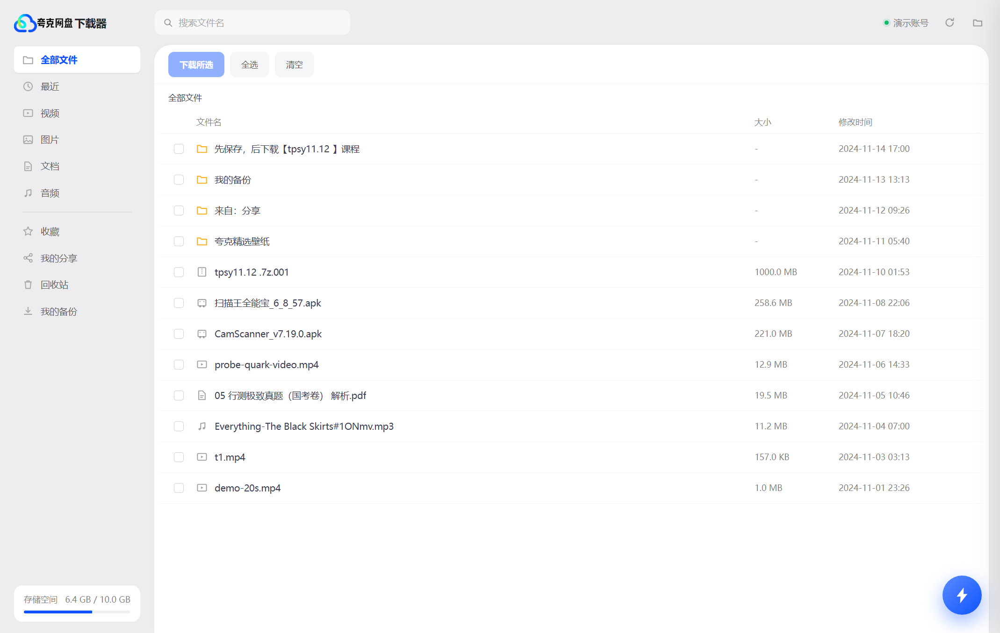
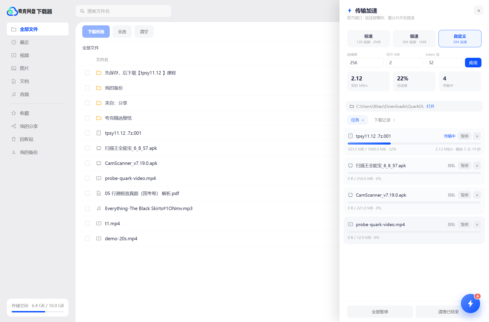

# 夸克网盘加速器 · QuarkAccel

> 把夸克网盘的下载速度从「几百 KB/s」拉到「几 MB/s」的 Windows 桌面工具。
> 不装驱动、不改系统、不解压压缩包、不动你的文件 —— 只是把「一个连接慢慢搬」变成「几百个连接一起搬」。

---

## 一句话原理

夸克官方网页版下载一个文件只开**一条 TCP 连接**，而服务端对单连接做了限速（实测 100–350 KB/s，视网络而定）。
QuarkAccel 做的事很朴素：把文件切成 **1 MB 的片**，开 **384 条并发连接**同时抓，抓完按偏移量写回同一个文件。

单连接被限速 → 并发数就是唯一的乘数。

| 方式 | 实测速度 |
|---|---|
| 官方网页版单连接 | 0.10 – 0.35 MB/s |
| QuarkAccel · 标准档（128 连接 / 2 MB 片） | 2.11 MB/s |
| **QuarkAccel · 极速档（384 连接 / 1 MB 片）默认** | **2.16 MB/s** |
| 512 连接（超出上限） | 服务端拒绝，不稳定 |

> 数字来自同一账号、同一文件、同一时段的 A/B 测试。绝对值随网络变化，倍数关系稳定。

---

## 功能

### 1. 三档传输策略，默认就是最快的

| 档位 | 连接数 | 切片 | Token 池 | 适合 |
|---|---:|---:|---:|---|
| 标准 | 128 | 2 MB | 16 | 挂机、不想占满带宽 |
| **极速（默认）** | **384** | **1 MB** | **48** | **大多数人、大多数网络** |
| 自定义 | 8 – 384 | 1 – 32 MB | 4 – 64 | 你有自己的调参经验 |

自定义档会**自动钳制**到合法区间（填 9999 连接会被压到 384），不会因为手抖把客户端打崩。

### 2. 视频边下边播，而且也是加速的

这是最容易做砸的地方。浏览器的 `<video>` 用 HTTP Range 请求顺序取数据，**如果直接让它去请求夸克，那它就只是一条被限速的连接** —— 4K 视频码率 3 Mbps，单连接只给 40 KB/s 时首帧永远出不来。

QuarkAccel 的做法：本地起一个支持 Range 的 HTTP 服务，`<video>` 请求的是**本机**，本机再从夸克并发预取。
播放器以为自己在一个超快的本地磁盘上读文件，实际上背后是 384 条连接在抢。

**实测首帧对照**（上游每连接限速 40 KB/s，视频码率 350 kbps）：

| 方案 | 首帧 | 播放 6 秒内卡顿 |
|---|---|---|
| 播放器直连夸克 | 从未出画 | — |
| QuarkAccel（初版） | 11.0 s | 0 |
| **QuarkAccel（调优后）** | **4.1 s** | **0** |

三处关键调优：

1. **预览切片降到 256 KB** —— 切片是「可播放」的最小单位，片越小首帧来得越快；
2. **开头 2 MB 用纳米片**（64 KB 起爬坡）—— 播放器刚起播时只要前几百 KB，用 1 MB 片等于让它干等；
3. **moov 在末尾的 MP4 先把文件尾部 1 MB 排到队首** —— 大量 MP4 的索引在文件末尾，不先取它，播放器连时长都读不出来。

### 3. 真的会校验，不是「显示完成」

一个文件下完，QuarkAccel 会：

1. 逐片核对**偏移量**（服务端忽略 Range 返回 200 时会被判定失败，而不是把文件开头写进中间悄悄花屏）；
2. 抽查 3 片做**逐字节比对**；
3. 对整个文件做**头 / 中 / 尾三段复核**。

任何一步不过，文件旁边会留下 `.qbad` 标记，界面显示失败 —— 不会给你一个看着完整、打开报损坏的包。

### 4. 断点续传，切片参数变了也不会错

`.qstate` 里记录的是「哪些片已完成」，同时记下当时的**文件大小和切片尺寸**。
你换档位（1 MB → 4 MB）之后再续传，旧的片号不会被当新片号用 —— 这是很多下载器的经典假完成 bug，这里专门堵了。

### 5. 登录就是扫码

点右上角「登录」→ 弹出一个独立的浏览器窗口 → 手机夸克 App 扫码 → 回来点「我已完成登录」。
工具通过 CDP 从那个窗口读 Cookie，读到就自动关窗。

不想扫码？也可以 F12 → Network → 任意请求 → 复制 Cookie 整行粘进来。

---

## 怎么用

1. 下载 `QuarkAccel.exe`（16.6 MB，单文件，无需安装、无需 Python）；
2. **放在一个可写目录**（桌面、下载、文档都行）—— 单文件版启动时会在自己旁边解压运行时，放 `C:\Program Files` 会因无写权限起不来；
3. 双击。第一次启动可能白屏 9 秒左右，那是它在试标准参数启动内置浏览器，超时后自动降到兼容参数重启，然后就出来了（日志里会写「降级启动成功」）；
4. 点「登录」扫码；
5. 勾文件 → 下载所选。

界面仿夸克网盘网页版：左侧导航（全部文件 / 最近 / 视频 / 图片 / 文档 / 音频 / 收藏 / 分享 / 回收站）、顶栏搜索、中间文件表、右侧传输抽屉、右下角悬浮球显示任务数。
分类导航是本地过滤，不额外打接口，点一下就出结果。

---

## 支持与不支持

**支持**：夸克网盘里的普通文件、整个目录（递归展开）、回收站与最近列表、大文件（实测 1 GB 级）、断点续传、边下边播（mp4 / webm / m4v）。

**不支持**：BT / 磁力（本工具不碰 P2P）；mkv / rmvb / avi 的在线预览（浏览器原生解不了这些容器，能下不能播）；分享链接免登录下载（需要你自己的账号）。

---

## 技术栈

Python 3.12 + 原生 `http.server` + Edge（`--app` 模式当壳）+ 原生 HTML/CSS/JS。
没有 Electron、没有 WebView2 的 python binding、没有前端框架。
打包用 PyInstaller onefile，成品 16.6 MB。

---

## 说明

- 工具本身**不含任何账号信息**，用你自己的夸克账号登录，速度上限取决于你的账号类型和网络；
- 个人项目，界面和交互按自己的使用习惯做的，不承诺兼容所有版本；
- 本项目**只发布可执行文件和文档，不公开源码**。

---

如果它帮你省下了几个小时的等待时间，给个 Star 就行。
