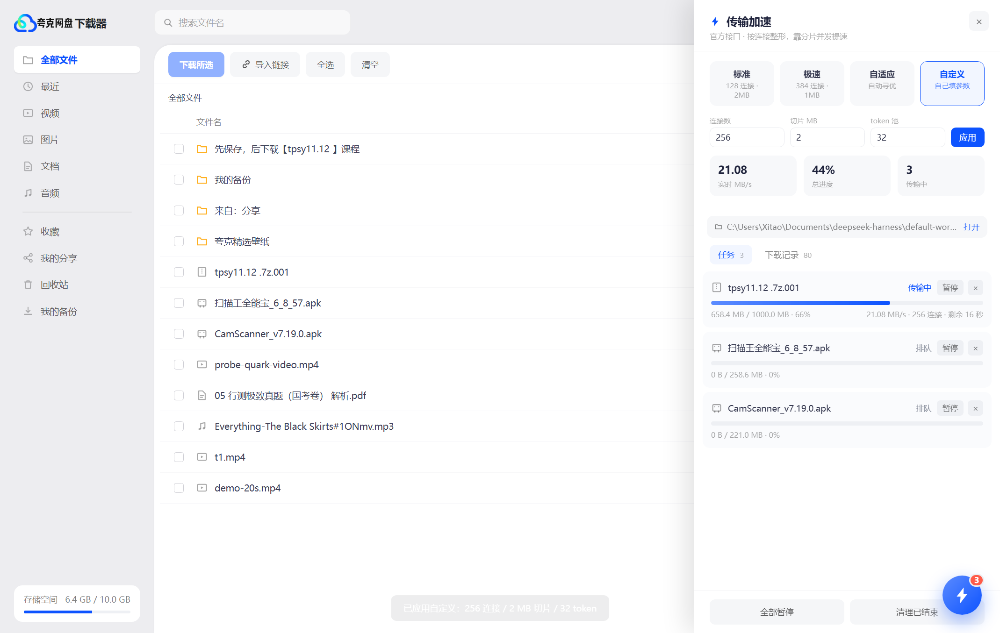
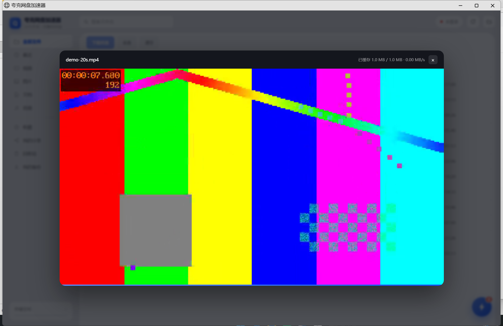
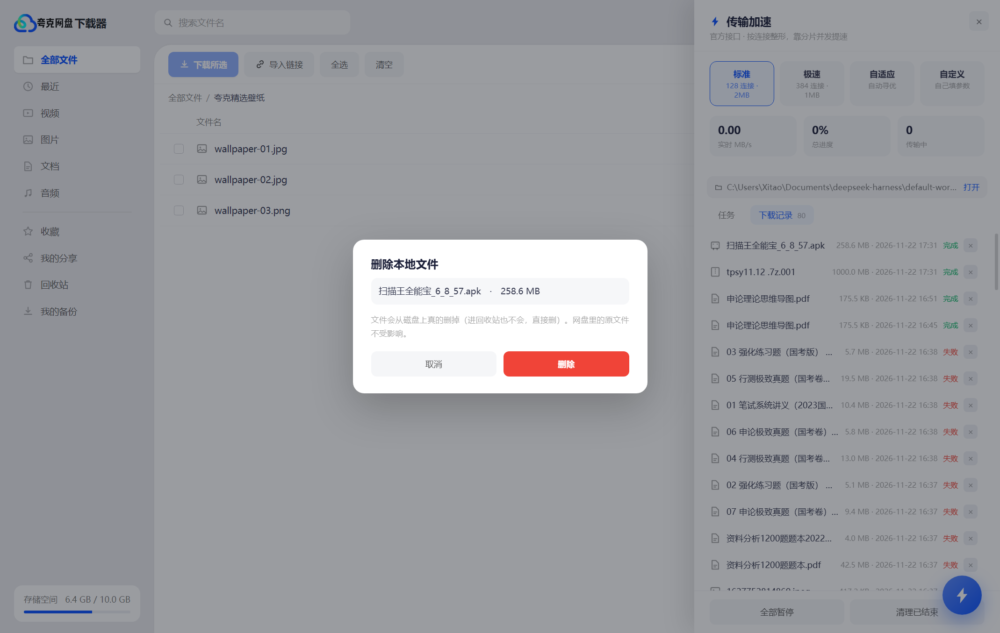
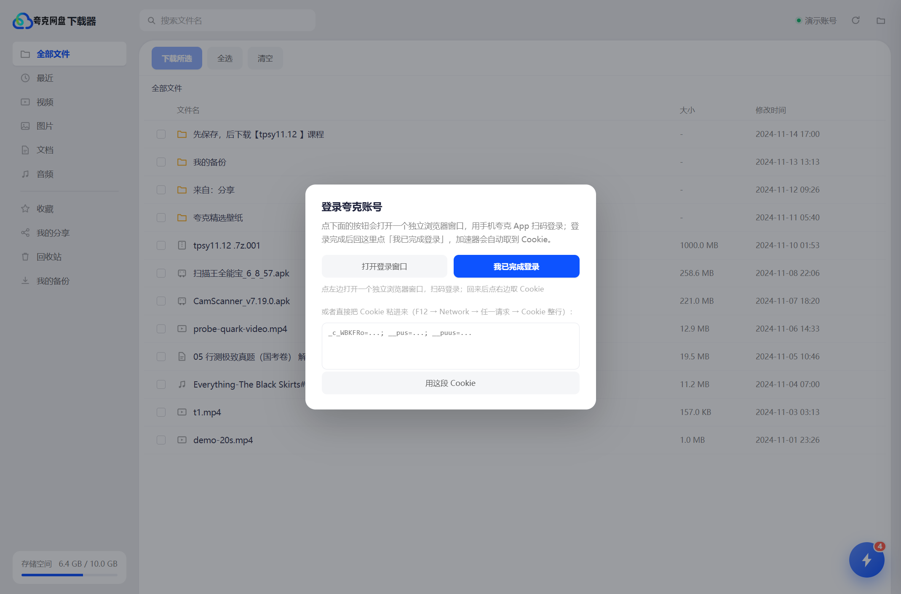
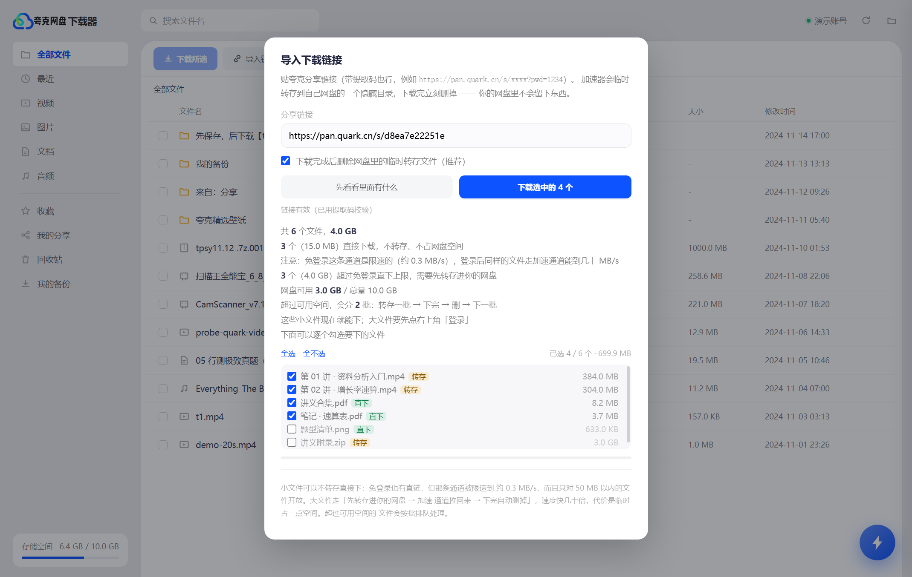

# 夸克网盘下载器 · QuarkAccel

> 把夸克网盘的下载速度从「几百 KB/s」拉到「几十 MB/s」的 Windows 桌面工具。
> 不装驱动、不改系统、不解压压缩包、不动你的文件 —— 只是把「一个连接慢慢搬」变成「一群连接一起搬，并且自己找该开几条」。

---

## 一句话原理

夸克官方网页版下载一个文件只开**一条 TCP 连接**，服务端对单连接做了限速（实测 100–350 KB/s）。
QuarkAccel 把文件切成 **1 MB 的片**，开**多条并发连接**同时抓，抓完按偏移量写回同一个文件。

单连接被限速 → 并发数就是唯一的乘数。**但并发不是越多越快**，这一点下面单独讲。

| 方式 | 实测速度 |
|---|---|
| 官方网页版单连接 | 0.10 – 0.35 MB/s |
| QuarkAccel（默认极速档，384 条并发） | **20 – 48 MB/s** |
| 固定 384 条连接（老版本做法） | 前几秒快，随后塌到 1 MB/s 上下 |

> 数字来自同一账号、同一文件、同一时段的对照测试。绝对值随网络变化，倍数关系稳定。

---

## 功能

### 1. 并发不是越多越好：所以留了一档「自适应」

这是这一版最重要的改动。老版本默认 384 条连接，结果在一台普通机器上只能跑 **2.16 MB/s** —— 而同一个 100 MB 对象、同一台机器，单点实测是这样的：

| 并发连接 | 实测吞吐 |
|---:|---:|
| 8 | 41.9 MB/s |
| 16 | 43.1 MB/s |
| 32 | **47.7 MB/s** |
| 64 | 1.7 MB/s |
| 128 | 0.0 MB/s（400 次连接超时，一片都没下成） |

夸克对同账号的连接数有软上限。开到 384 条时握手阶段就开始排队超时，一批连接反复重试，**吞吐反而塌下来**，界面上只剩 2 MB/s 的假象。多出来的连接不是速度，是负担。

所以有一档专门干这件事叫**自适应**（`quark_core.py` 里的 `Governor`）：

1. 从 16 条起**慢启动**往上探，每档观察 1 秒真实吞吐；
2. 吞吐还在涨就继续加（每步 +4 或 ×1.5，不会一次跳过甜点区）；
3. 撞到不涨就**二分收缩**，在上下界之间收敛；
4. 连续两次连接超时立刻回撤，不等统计窗口；
5. 换档时丢掉混合窗口，不拿新旧档混着的数据做判断。

同一段塌陷网络、同样 128 MB：

| 策略 | 平均吞吐 | 用时 | md5 |
|---|---:|---:|---|
| 固定 384 连接 | 1.00 MB/s | 128.1 s | ✅ |
| 固定 16 连接（理论最优） | 10.66 MB/s | 12.0 s | ✅ |
| **自适应（16 → 24 收敛）** | **9.84 MB/s** | **13.0 s** | ✅ |

**自适应把「死磕 384」提速约 10 倍**，并且逼近理论最优，而用户不用自己猜档位。

任务行会显示当前**实际在飞的连接数**（例如「21.95 MB/s · 24 连接」）—— 停在 24 或 32 不是被限速，是它已经找到最好的位置了。

自适应是**独立的一档**，不是偷偷加在所有档位上。默认仍然是「极速」：直接铺满 384 条，不试探、不降档，手感跟以前一样。选哪个档就按哪个档跑。

### 2. 四档传输策略

| 档位 | 连接上限 | 切片 | Token 池 | 适合 |
|---|---:|---:|---:|---|
| 标准 | 128 | 2 MB | 16 | 挂机、不想占满带宽 |
| **极速（默认）** | **384** | **1 MB** | **48** | **大多数人、大多数网络**，设多少开多少 |
| 自适应 | 384（起手 16 往上探） | 1 MB | 48 | 网络情况不明、想吃满又不确定甜点在哪 |
| 自定义 | 8 – 384 | 1 – 32 MB | 4 – 64 | 你有自己的调参经验 |

固定档（标准 / 极速 / 自定义）给的是**上限，也是实际值**：选 384 就 384 条同时在飞，不做试探也不降档，只有连续撞上连接超时才折半回撤一次保命。自定义档会**自动钳制**到合法区间（填 9999 会被压到 384）。

几 MB 到几十 MB 的小文件别用自适应 —— 爬坡还没爬完文件就下完了，直接「极速」更快。

### 3. 实时速度是真的在算，不是估的

速度取服务器**实际发出的字节数**，滑动窗口 2 秒。逐秒对照本地限速服务器（报告值 / 同期实测值）：

| 时刻 | 界面显示 | 实测 |
|---|---:|---:|
| 1 | 17.73 MB/s | 18.06 MB/s |
| 2 | 19.55 MB/s | 20.74 MB/s |
| 3 | 19.05 MB/s | 15.68 MB/s |
| 4 | 15.37 MB/s | 15.24 MB/s |

任务停下（完成 / 暂停 / 取消）后数字**立刻归零**，不会挂着上一秒的读数让人以为还在偷偷跑。

### 4. 视频边下边播，而且也是加速的

浏览器的 `<video>` 用 HTTP Range 顺序取数据，**让它直接请求夸克，它就只是一条被限速的连接** —— 4K 视频码率 3 Mbps，单连接只给 40 KB/s 时首帧永远出不来。

QuarkAccel 在本地起一个支持 Range 的 HTTP 服务，`<video>` 请求本机，本机再从夸克并发预取。播放器以为自己在一个超快的本地磁盘上读文件，实际背后是几十条连接在抢。

**实测首帧对照**（上游每连接限速 40 KB/s，视频码率 350 kbps）：

| 方案 | 首帧 | 播放 6 秒内卡顿 |
|---|---|---|
| 播放器直连夸克 | 从未出画 | — |
| QuarkAccel（初版） | 11.0 s | 0 |
| **QuarkAccel（调优后）** | **4.1 s** | **0** |

三处关键调优：

1. **预览切片降到 256 KB** —— 切片是「可播放」的最小单位，片越小首帧来得越快；
2. **开头 2 MB 用纳米片**（64 KB 起爬坡）—— 播放器刚起播只要前几百 KB，用 1 MB 片等于让它干等；
3. **moov 在末尾的 MP4 先把文件尾部 1 MB 排到队首** —— 大量 MP4 的索引在末尾，不先取它，播放器连时长都读不出来。

另外修了一个很隐蔽的问题：以前点播放键是「先等接口返回，再设置视频地址并播放」，等接口回来时那次点击的用户手势早就过期了，Chromium 会把播放拒掉 —— 表现是弹层里一直转圈停在 0:00。现在视频地址和播放都在点击手势内同步发出，打包版实测出画到 t=4.9 秒、640×360、正常播放。

### 5. 真的会校验，不是「显示完成」

一个文件下完，QuarkAccel 会：

1. 逐片核对**偏移量**（服务端忽略 Range 返回 200 时会被判定失败，而不是把文件开头写进中间悄悄花屏）；
2. 抽查 3 片做**逐字节比对**；
3. 对整个文件做**头 / 中 / 尾三段复核**。

任何一步不过，文件旁边会留下 `.qbad` 标记，界面显示失败 —— 不会给你一个看着完整、打开报损坏的包。

### 6. 断点续传，切片参数变了也不会错

`.qstate` 里记录「哪些片已完成」，同时记下当时的**文件大小和切片尺寸**。
换档位（1 MB → 4 MB）之后再续传，旧的片号不会被当新片号用 —— 这是很多下载器的经典假完成 bug，这里专门堵了。

### 7. 暂停、取消、重试、下载记录

| 状态 | 任务行上的按钮 |
|---|---|
| 传输中 | 暂停 · ×（取消） |
| 排队 | 暂停 · ×（取消） |
| 已暂停 | **继续** · ×（从列表移除） |
| 完成 | 打开（资源管理器里选中该文件）· **删除** · ×（从列表移除） |
| 失败 | **重试** · **删除** · ×（从列表移除） |

- **暂停**是立刻生效的：点下去状态马上变「已暂停」、速度归零，不用等当前分片收完；
- **继续**从 `.qstate` 记录的偏移接着下，不重头来；
- **取消**会同时叫停后台下载器并写一条「已取消」记录，不会出现「界面显示已取消、磁盘还在写」；
- **删除**是连磁盘文件一起删（不是从列表移除）：确认框里带文件名和大小，点下去连 `.qstate` / `.qbad` 一起清掉，弹一句「已删除 xxx，释放 221 MB」；正在下的任务不让删，先取消再删；
- **下载记录**是独立标签页，完成 / 失败 / 取消都会记一条（文件名、大小、时间、状态），**重启后还在**，点一行直接在资源管理器里定位文件；每行右侧也有红色「删除」，清历史时顺手把文件删掉；
- 队列用「队列消费中」标志判断要不要起工作线程，不会出现任务永远停在「排队」；
- 单个任务抛异常只让那一条变失败，后面的任务照常继续。

### 8. 登录就是扫码

点右上角「登录」→ 弹出一个独立的浏览器窗口 → 手机夸克 App 扫码 → 回来点「我已完成登录」。
工具通过 CDP 从那个窗口读 Cookie，读到就自动关窗。也支持 F12 → Network → 复制 Cookie 整行粘进来。

登录窗口 0.3 秒出二维码；重复点会复用同一个窗口（约 40 毫秒），不会越点越多。窗口自带白屏自愈，也用同一套参数记忆。

### 9. 界面用的是夸克自己的素材

左上角的图标和「夸克网盘」字标不是照着画的，是从夸克官网 header 上直接抠下来的原图；应用图标（窗口 / 任务栏 / 资源管理器里那个蓝 Q）来自官方 Windows 客户端 7.4.7.1036 自带的多尺寸 ico。

| 位置 | 来源 |
|---|---|
| 侧栏品牌区图标 | 官网 header logo 抠图，106×85 PNG |
| 侧栏「夸克网盘」字标 | 同一张图里抠出的字标，288×84 PNG |
| 应用图标 | 官方客户端 quark.ico，16/24/32/48/64/128/256 七个尺寸逐张重建 |

配套的界面调整：

- 品牌区 = 官方图标 + 官方字标 + 「下载器」三个字，原来那行「分片并发 · 完整性校验」副标题已删；
- 顶栏不再是叠白卡片，改成跟页面同底色，只留一条淡描边搜索框，鼠标移上去才浮起很浅的投影；
- 左下角存储空间真的会读网盘容量（登录后自动刷新，「已用 / 总量」加进度条），点一下会报出具体数字；
- 产品名统一成「夸克网盘下载器」——窗口标题、exe 属性、任务管理器里都是这五个字；
- 修了一个很烦的导航 bug：以前点进子目录，面包屑会变但列表还是根目录的内容；现在每个目录有自己的一份列表，面包屑每一级都能点回去。

### 10. 粘一条分享链接就能下

工具条上有个「导入链接」：把 `https://pan.quark.cn/s/xxxxxxxx?pwd=abcd` 粘进去，点「先看看里面有什么」，它会把整个分享**递归**展开成文件清单，标出每个文件走哪条路，然后一键下完——不用先手动转存、再在网盘里翻出那一堆文件。

清单能逐个勾选：默认全勾，取消掉的那些不会下（也就不会为它转存、不占空间）。下面一行显示「已选 12 / 48 个 · 1.2 GB」，按钮跟着变成「下载选中的 12 个」，旁边还有「全选 / 全不选」。分享里文件太多时清单只列前 500 个，这时候点全选下发的是「全都要」，后端自己再列一遍，不会漏。

两条通道，按「哪条更快」自动选：

| 情况 | 走哪条 | 速度 | 代价 |
|---|---|---|---|
| 没登录，文件 ≤ 48 MB | 免转存直下 | 约 0.3 MB/s | 不写你的网盘 |
| 没登录，文件 > 48 MB | 会提示先登录 | — | 分享直链对 >50 MB 返回 `23018` |
| 已登录 | 转存 → 加速通道 → 下完删掉 | 几十 MB/s | 临时占一点空间，结束自动清 |

游客直链是另一套 CDN（`dl-guest-*.drive.quark.cn`），实测单流 0.49 MB/s、8 并发直接超时；而登录后走自己网盘那条链实测 47.7 MB/s。所以只要登录了，连小文件也照样走转存——多花两秒转存，换来几十倍速度。

几个踩过的坑，都写进代码注释了：

- 免转存直链靠 `POST /file/share/download`，不转存不登录也能拿，但**体积上限约 50 MB**（399 MB、1000 MB 一律报 `23018`，改 `range_size`/`range` 参数绕不过去，是服务端按设备类型判的）；
- 直链请求**必须带同一会话的游客 Cookie**，否则 412；而且那条 Cookie 里必须有 `__pugs`，它是取直链那次响应才种下来的，所以 Cookie 头是懒取的，构造时就拼只有半条；
- 分享直链接口返回的 `md5` 字段**不是内容 md5**，真实值在 CDN 响应头 `Content-MD5`（base64）。校验一律用后者，否则好文件会被全判成坏文件；
- 转存按批走：一批最多 8 GB / 100 个文件，每批下完就删掉网盘上的临时文件，收尾连临时目录一起删；中途点「停止」会逐任务取消再等 3 秒收尾，不留半截文件。

真机实测（一个 48 文件 / 4.5 GB 的分享）：清单正确展开，游客态 43 个判为可直下、5 个要求登录；抽 3 个走完整链路下载，三个文件的 md5 与 `Content-MD5` 全部一致。

---

## 怎么用

1. 下载 `QuarkAccel.exe`（约 10.2 MB，单文件，无需安装、无需 Python）；
2. **放在一个可写目录**（桌面、下载、文档都行）—— 单文件版启动时会在自己旁边解压运行时，放 `C:\Program Files` 会因无写权限起不来；
3. 双击。只有在需要兼容参数的机器上第一次才会白 9 秒左右（试标准参数启动内置浏览器 → 超时 → 自动降到兼容参数重启），之后这套参数会被记住，**冷启动约 1 秒直出界面**；
4. 点「登录」扫码；
5. 勾文件 → 下载所选。速度、连接数、剩余时间都在右侧抽屉里实时更新。

界面仿夸克网盘网页版：左侧导航（全部文件 / 最近 / 视频 / 图片 / 文档 / 音频 / 收藏 / 分享 / 回收站）、顶栏搜索、中间文件表、右侧传输抽屉、右下角悬浮球显示任务数。分类导航是本地过滤，不额外打接口。

---

## 支持与不支持

**支持**：夸克网盘里的普通文件、整个目录（递归展开）、回收站与最近列表、大文件（实测 1 GB 级）、断点续传、边下边播（mp4 / webm / m4v）、分享链接导入（登录后转存加速；未登录时 50 MB 以内小文件可免转存直下）。

**不支持**：BT / 磁力（本工具不碰 P2P）；mkv / rmvb / avi 的在线预览（浏览器原生解不了这些容器，能下不能播）；未登录下载 50 MB 以上的分享文件（游客直链有体积上限，登录即可）。

---

## 技术栈

Python 3.12 + 原生 `http.server` + Edge（`--app` 模式当壳）+ 原生 HTML/CSS/JS。
没有 Electron、没有 WebView2 的 python binding、没有前端框架。
打包用 PyInstaller onefile，成品约 10.2 MB。

---

## 说明

- 进程枚举与清理走 Windows 系统 API，不调用 PowerShell，所以点登录不会闪黑框；
- 连接池按并发上限预置（`HTTPAdapter(pool_maxsize=256)`），提前结束的分片会 `r.close()` 把连接还回池子 —— 少了这一步吞吐会掉一半；
- 「打开下载目录」在受限令牌下（比如从某些 IDE、计划任务或沙箱里启动）会依次试 `ShellExecute` / `explorer` / `cmd start` / PowerShell，并用窗口枚举确认真的弹出来了；四种都不行就退化成弹窗列出目录内容 + 完整路径 + 复制路径按钮，结论会缓存住，第二次点不会再让你干等；
- 工具本身**不含任何账号信息**，用你自己的夸克账号登录，速度上限取决于你的账号类型和网络；
- 个人项目，界面和交互按自己的使用习惯做的，不承诺兼容所有版本；
- 本项目**只发布可执行文件和文档，不公开源码**。

---

如果它帮你省下了几个小时的等待时间，给个 Star 就行。
